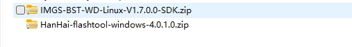
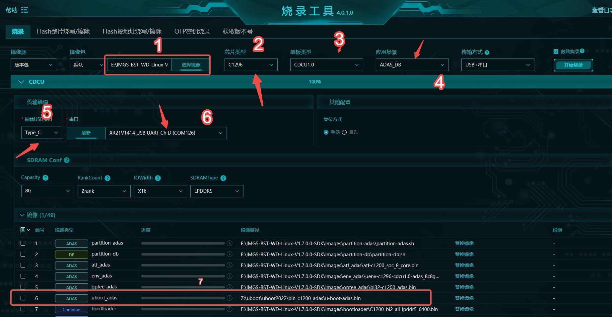

# C1200 Firmware Flash

This guide describes how to flash C1200 firmware and install a Linux distribution on the C1200 CDCU.

## Flash the Firmware

1. Obtain the software version and flashing tools from the BlackSesame version URL. Contact the BlackSesame team to obtain them.

   Example:

   

2. Open the flashing tool.

   

3. Configure the flashing tool:

   - Select the version archive.
   - Select C1296.
   - Select CDCU1.0.
   - Select the ADAS_DB template.
   - Select Type-C.
   - Select chD.
   - Check uboot, and replace it with the U-Boot build that supports UEFI.

4. Start flashing.

## Install the Distribution

1. Write the distribution ISO to an SD card using dd, then insert the SD card into the C1200 CDCU.
2. Configure the U-Boot environment variables to boot from the SD card.
3. Install the distribution.
4. Reboot the target.
